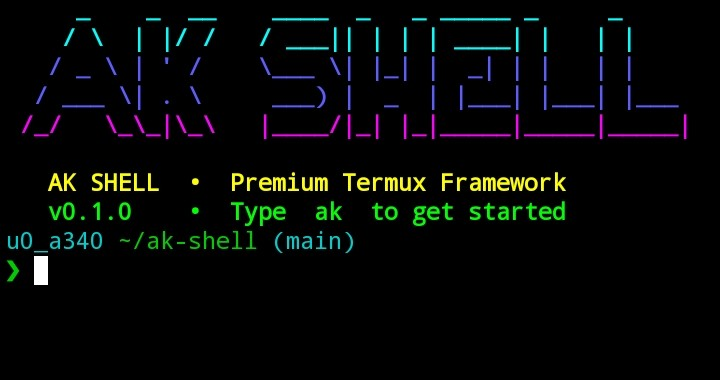
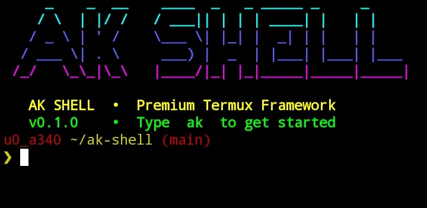

<div align="center">

# 🚀 AK SHELL

**The Ultimate Premium Termux Shell Customization Framework.**

[](https://opensource.org/licenses/MIT)
[](https://termux.com/)
[](https://www.zsh.org/)
[](http://makeapullrequest.com)

*Transform your basic Termux terminal into a beautiful, intelligent, and highly productive environment. Built for speed, aesthetics, and power users.*

</div>

---

## 📸 Screenshots

<div align="center">
  <!-- Screenshots yahan aayenge. Neeche wale links ko apne uploaded images ke naam se replace karein -->
  
  &nbsp; &nbsp;
  
</div>
<div align="center">
  <i>Left: CYBER Theme with custom banner • Right: BLOOD Theme with git status</i>
</div>

---

## ✨ Features

- 🎨 **10 Premium Built-in Themes**: Cyber, Ghost, Blood, Royal, Arctic, Matrix, Ocean, Minimal, AMOLED, and Retro.
- ⚡ **Blazing Fast**: Optimized for mobile devices (AArch64/ARM).
- 🧠 **Intelligent Suggestions**: Zsh autosuggestions based on your history.
- 🌈 **Live Syntax Highlighting**: Valid commands and errors are highlighted as you type.
- 🚀 **Powerful Prompt**: Git integration, exit codes, and dynamic path shortening.
- 🛠️ **Interactive CLI**: Full control using the `ak` command.
- 🎬 **Cinematic Loaders**: Custom startup animations (progress, spinner, boot, matrix).

---

## 📦 Installation

Open Termux and run the following commands:

**1. Clone the repository:**
```bash
git clone https://github.com/Hariskhan420333/ak-shell.git
cd ak-shell
```

2. Run the installer:

```bash
chmod +x install.sh
./install.sh
```

3. Make Zsh your default shell (Auto-load on startup):

```bash
chsh -s zsh
touch ~/.hushlogin
```

(This ensures AK SHELL loads automatically every time you open Termux, replacing the default welcome message).

4. Restart Termux!

---

🎮 Usage (The ak Command)

AK SHELL comes with a powerful CLI tool called ak to manage your environment.

Command Description
ak or ak menu Opens the interactive Control Center
ak theme list Lists all available themes
ak theme set <name> Changes the current theme (e.g., ak theme set cyber)
ak config user <name> Sets a custom username for your prompt
ak banner text <text> Changes the big ASCII text in the banner
ak banner reset Resets banner to default
ak loader set <style> Sets loading animation (progress, spinner, boot, matrix, none)
ak doctor Checks system health and dependencies

---

🎨 Available Themes

Theme Description
Cyber Neon green, cyan, and deep black.
Ghost Purple, violet, and cyan accents.
Blood Red, dark crimson, and black.
Royal Gold, amber, and charcoal.
Arctic Ice blue, white, and cool gray.
Matrix Classic green terminal look.
Ocean Deep blue and turquoise.
Minimal Clean and distraction-free.
AMOLED Pure black-friendly with restrained accents.
Retro Vintage computer inspired.

---

🗑️ Uninstallation

Want to revert to your original setup? Just run:

```bash
~/.ak-shell/uninstall.sh
```

(This safely removes AK SHELL without harming your personal Termux files).

---

🤝 Contributing

Pull requests are welcome! For major changes, please open an issue first to discuss what you would like to change.

📄 License

This project is licensed under the MIT License.
